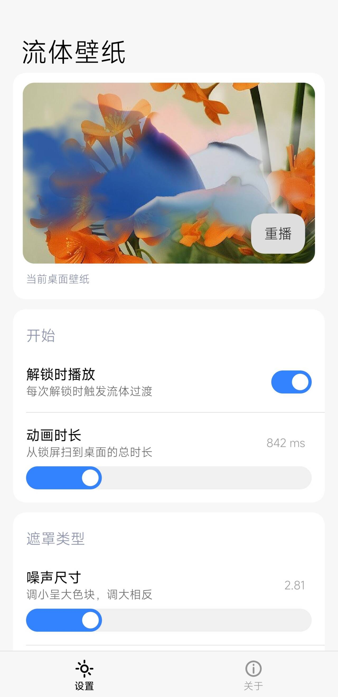

# 流体壁纸 · FluidWall
这是一个 LSPosed 模块

给小米桌面加一点流动感：每次解锁，一层流动的噪点遮罩会像颜料一样把锁屏壁纸慢慢冲开，露出下面的桌面壁纸。



> 设置页截图。顶部可以预览过渡效果，下面的滑杆实时生效。

## 功能

- **解锁播放**：开关控制是否触发，动画时长 300–3000 ms 可调
- **遮罩调节**：噪声尺寸、边缘软硬、中心扩散、扭曲、色晕、颗粒，都能实时调
- **跟随壁纸取色**：从当前壁纸里提取主色，过渡边缘会带一点这个颜色
- **兜底**：设备不支持 AGSL RuntimeShader 时退回圆形扩散，不至于没效果

## 支持情况

| 项目 | 说明 |
| --- | --- |
| Android | 13 及以上（RuntimeShader 需要 API 33） |
| 系统 | HyperOS / MIUI 的小米桌面，在小米 14 Ultra / Android 16 上测试 |
| 框架 | LSPosed（libxposed API 101） |
| 作用域 | `com.miui.home`、`com.miui.miwallpaper` |

其他 ROM 的桌面类名不一样，模块不会崩，只是不会播放动画。

## 安装

1. 安装 `app-release.apk`，或者自己构建一个
2. 在 LSPosed 里启用「流体壁纸」，作用域勾选 **系统桌面** 和 **壁纸**
3. 重启桌面，或者直接重启手机
4. 锁屏，再解锁

第一次用建议锁屏后等两秒再解锁，让壁纸缓存先准备好。

## 构建

需要 JDK 17 及以上（推荐 21）和 Android SDK（`compileSdk 37` 对应的 platform 与 build-tools）。SDK 位置用 `ANDROID_HOME` 或 `local.properties` 里的 `sdk.dir` 指定。

```bash
git clone <仓库地址> FluidWall
cd FluidWall
./gradlew :app:assembleRelease
```

产物在 `app/build/outputs/apk/release/app-release.apk`。

- AGP 9.3.1 / Gradle 9.6.1 / Kotlin 2.3.21，界面用 Compose + Miuix 0.9.3
- 签名用的是仓库里的 `keystore/fluidwall.jks`（store/key 密码都是 `fluidwall`），只是为了方便复现构建，发布前请换成自己的
- 根目录的 `app-release.apk` 是打好的 v1.0，源码之后如果又改过，可能比它新

用 Android Studio 打开也一样，先配好 SDK 就行。

## 大致怎么做的

**取壁纸。** Android 13+ 普通 App 读不到壁纸，所以由壁纸进程（`com.miui.miwallpaper`）通过 hook 读出锁屏和桌面壁纸，再用 `ContentProvider.call()` 分块写到模块 App 的私有目录。设置页直接读缓存做预览，解锁时也用这份缓存兜底。

**放图层。** 在桌面的 `decorView` 第 0 层插一个全屏的 `FluidTransitionView`，位置在壁纸之上、图标之下。锁屏期间这个 View 先显示锁屏壁纸的静态帧，解锁时就不会闪一下桌面壁纸。

**画过渡。** AGSL 里用 4 阶 fbm 值噪声叠 3×3 Voronoi 生成一张遮罩场，阈值随 `uProgress` 从 0.74 扫到 0.26，`smoothstep` 得到软边；边缘叠色晕、颗粒和域扭曲，最后 6% 的进度强制铺满，保证收尾一定是完整的桌面壁纸。两张壁纸作为 `BitmapShader` 输入，一次 `drawRect` 完成混合。

**找时机。** 主要 hook 桌面自己的解锁动画入口（`UnlockAnimationStateMachine#onUserPresent`、`UserPresentAnimationCompat*#showAnimation`），比 `USER_PRESENT` 广播更早；再用 `KeyguardManager` 状态和亮屏/息屏兜底。每个锁屏周期只播一次。

## 目录

```
app/src/main/java/com/eta/fluidwall/
├── MainActivity.kt, SettingsScreen.kt          设置界面（Compose + Miuix）
├── core/
│   ├── FluidShader.kt                          AGSL 着色器
│   ├── FluidTransitionView.kt                  播放过渡的 View
│   ├── LauncherLayer.kt                        挂在桌面上的图层和播放时机
│   ├── ColorKMeans.kt                          壁纸取色
│   ├── WallpaperBridge.kt / WallpaperStore.kt / WallpaperCache.kt   壁纸读取与缓存
│   └── FluidConfig.kt / ConfigProvider.kt      配置项与跨进程读取
└── xposed/
    ├── FluidModule.kt                          LSPosed 入口
    ├── HookLauncher.kt                         桌面进程 hook
    └── HookWallpaper.kt                        壁纸进程 hook
```

## 调试

```bash
# 模块日志
adb logcat -s FluidWall

# 手动播一次过渡，不用真的锁屏
adb shell am broadcast -a com.eta.fluidwall.LAYERTEST

# 自检：着色器能否编译、壁纸能否读到
adb shell am broadcast -a com.eta.fluidwall.SELFTEST
```

## 已知问题

- 只适配了小米桌面，其他桌面要自己补 hook 的类名
- 依赖系统的内部类（`UserPresentAnimationCompat*` 这些），系统大版本更新后可能失效
- 过渡是画在桌面窗口里的，不碰 SurfaceFlinger，所以盖不住状态栏和导航栏

---
